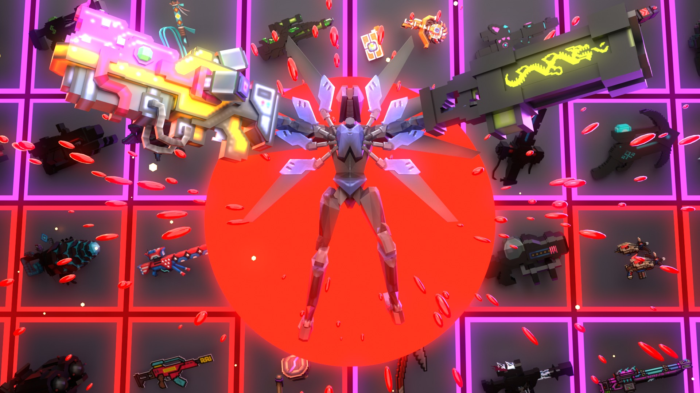

# ULTRAKILL: Pixel Arsenal

Pixel Gun 3D's 1100+ weapons in ULTRAKILL, read from your own copy of Pixel Gun 3D: real models, textures and sounds, a PG3D-style armory (B), charge-to-dash weapons, wiki-checked rarities and co-op on Melty Net.

Play it on Melty: https://melty.gg/m/ultrakill-pixel-arsenal

## Build
`python tools/build_net.py <version>` finds ULTRAKILL (with BepInEx, which Melty installs) and builds `dist/PixelArsenal-<version>.zip`. Needs Python and the .NET SDK. See `CLAUDE.md` for the project map.

An unofficial fan mashup, not made or endorsed by the makers of ULTRAKILL or Pixel Gun 3D. No game files are included.
